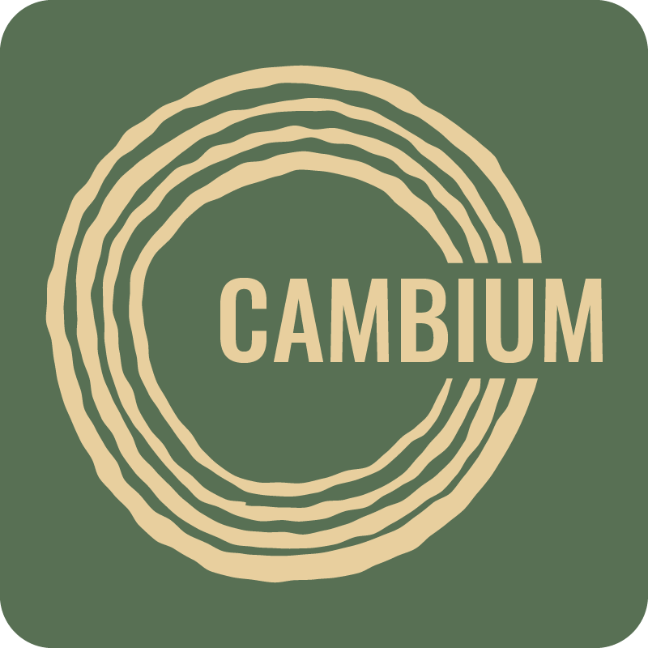

# Cambium

<!-- {height=250 .main-logo} -->

<!-- Image gets replaced in CSS -->

<!-- {.subtitle} -->
## Static Site Generator

Cambium is a static site builder that is focused on communication within and by scientific and technical teams. It takes directories of Markdown files and turns them into a static site that can be hosted anywhere without any special server setup. Cambium makes your information accessible and presentable right out of the box with the least amount of hassle.

<!-- {.docs-index-nav} -->
- [Code](https://github.com/sidratresearch/cambium)
- [Get Started](./get-started.md)
- [PyPI](https://pypi.org/project/cambium/)

## Features

Cambium is batteries-included for many use cases. Right out of the box, you get:

- Full Markdown support, with GitHub Flavoured Markdown (tables, alerts, automatic heading anchors)
- A modern and featureful theme with light and dark modes
- Client-side sitewide search

## Why Cambium

We built Cambium because we needed a way to help scientific and technical teams rapidly communicate information amongst the group with the least effort. We needed something that worked right out of the box, but also had the capability to grow with the team.

## Try it yourself

1. Install Cambium: `pip install cambium`
2. In your directory of Markdown files run: `cambium`
3. Your website will be in the new directory `_build/`

## Who are we

Cambium is a project of [Sidrat Research](https://www.sidratresearch.com/).

## Licensing

The Cambium source code and documentation are provided under a permissive MIT License.

Cambium bundles additional files and content distributed under other licenses and copyrights. For example, the default theme uses fonts and icons licensed under the SIL Open Font License and Font Awesome Free License. Where this is the case, these licenses and attendant copyright information are packaged alongside the relevant assets.

The Cambium source is hosted [on GitHub](https://github.com/sidratresearch/cambium).

## Status and future outlook

We created Cambium because it's a tool we wanted to use. We use Cambium for our own projects, which necessitates continued support. Cambium has undergone several months of planning, design, and development. We have full intentions of continuing to use, develop, and share Cambium for both our benefit and yours.

Cambium is currently listed as in-development, and while major API changes are not intended, there may well be modifications to individual stages and configuration options.

Cambium is currently being developed in-house based on our needs and use cases. We do not currently have a public roadmap, but we do have many planned features, from further Markdown extensions, to field-specific interactive preview pages. External contributions are welcome, and developer documentation will be added in the future. If you would like to contribute or suggest features, please get in touch [on GitHub](https://github.com/sidratresearch/cambium).

<!-- ## What is Cambium an alternative to? -->
